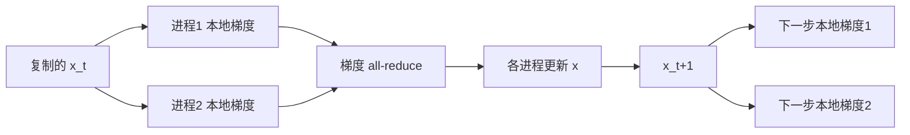

# 计算复杂度、计算 DAG 与通信代价

目录：成本口径 → 成本台账 → DAG → 通信 → 扩展性 → 教学例 → 输出检查。

## 1. 先定义模型和参数

先给符号表，再给 O(·)。按论文使用的变量取子集：n 未知量/矩阵阶数，m 样本或约束数，z=nnz，r 秩，h 网格尺度，κ 条件数，ε 目标误差，δ 失败概率，p 进程/设备数，M 每进程可用内存。化学论文另定义原子数、电子数、基函数数、k 点数等；不能把它们都写作含义不明的 N。

区分以下量：

| 量 | 口径 |
|---|---|
| 算术/逻辑工作量 F 或 W | 总操作量；说明 FLOP、oracle、bit operation 还是其他单位 |
| 收敛迭代数 kε | 达到明确精度指标所需迭代；确定性/期望/高概率；保留 κ、δ 等依赖 |
| 运行时间 T_p | 指定机器、数据布局、实现和计时边界下的时间 |
| 存储 S_peak | 全局/每进程峰值；常驻数据、临时缓冲、因子、halo、设备副本与通信缓冲 |
| 通信体积 V | bytes 或 words；每进程/最大进程/全局；发送量还是收发合计 |
| 消息数 S_msg | 指定统计范围内的点对点消息或启动次数；不等同于 collective API 调用数 |
| 轮数 R 与同步 | 算法依赖产生的通信阶段；不等同于消息数或迭代次数 |

RAM、bit、oracle、PRAM、BSP、外存、分布式内存和 LOCAL/CONGEST 是不同模型。论文只给 oracle complexity 时，保持其原本含义；补充运行成本必须另做推导。LOCAL 中不受限的消息大小与 CONGEST 中受限的消息大小会导致完全不同的轮数意义。

## 2. 建立成本台账

| 阶段/内核 | 调用次数 | 单次工作量 | 峰值额外内存 | 通信/同步 | 前提与来源 |
|---|---:|---|---|---|---|
| 数据读入、重排、分区、矩阵组装 | 按实际任务 | 条件式 | 条件式 | 条件式 | 是否进入计时 |
| 预处理/预条件/分解 | 一次或更新时 | 条件式 | 条件式 | 条件式 | 是否跨任务复用 |
| 外层更新与内层求解 | 按迭代计 | 条件式 | 条件式 | 条件式 | 内层容差与次数 |
| 投影、prox、线搜索、正交化等 | 不默认一次 | 条件式 | 条件式 | 条件式 | 是否隐含昂贵操作 |
| 停止检查、输出、checkpoint | 按检查频率 | 条件式 | 条件式 | 条件式 | 是否含全局归约/I/O |

总工作量首先写成可审计的和式：

\[
W_\varepsilon=W_{\rm setup}+\sum_{k=0}^{k_\varepsilon-1}
\left(W_{{\rm outer},k}+\sum_{j=1}^{J_k}W_{{\rm inner},k,j}\right)+W_{\rm final}.
\]

仅在各次成本具有适当统一界时再简化。J_k 未知就保留 J_k，不凭经验改成常数。多右端项、多时间步或重复任务中，可写每次摊销 setup/q，但同时报告首次成本和 q 的复用条件。

常见陷阱：

- 稀疏 matvec 常以 nnz 计；稀疏分解还依赖填充、排序和图结构，不能只由原矩阵 nnz 推断。
- 预条件器减少迭代，但构建/应用、额外内存及通信可能增加。
- 学习或压缩产生的离线成本、训练、数据生成、转换和精度损失不能默认为免费；说明是否计入当前使用场景。
- 降低渐近阶不等于所有规模更快。列出常数、启动、访存与实际规模区间，必要时估计交叉点并标为推导。
- 只减少部分内核 FLOP 的加速，受未优化阶段限制；不能把该内核加速倍数当作端到端收益。

## 3. 重建计算 DAG

**计算 DAG**描述运算或任务的数据依赖；**通信拓扑**描述进程之间允许/实际发生的连接；**调度图**描述任务被安排到机器与时间的位置。分别命名，不能互相替代。

选择能解释主要性能主张的粒度，如单次迭代、一个 tile、一个时间步或一个外层循环。对每个节点记录：

| 节点 | 运算 | 输入/输出及大小 | 所在进程/设备 | 工作量与内存 | 前驱/依赖理由 | 证据 |
|---|---|---|---|---|---|---|

边至少说明是真实数据依赖、写冲突、collective 完成条件或实现添加的同步。邻接表和节点表本身也是有效的 DAG 描述；图能澄清问题时再用 Mermaid。

循环不是 DAG：展示第 t 与 t+1 步的展开子图，或给单步 DAG 并在图外说明重复次数与跨步依赖。不要画 x→g→x 的环后称其为 DAG。分支依赖输入时，说明展示的是哪个分支，或描述控制规则。

在指定粒度和一致成本单位下，W 为所有节点工作量，D 为最长依赖路径成本，理想 p 个相同处理器至少满足

\[
T_p\ge\max(W/p,D),\qquad P_{\rm avg}=W/D.
\]

合适的贪心调度在理想模型中可得到 O(W/p+D) 量级的界；这需要忽略或明确建模通信、调度、存储和资源竞争，不能当作实际集群运行时间保证。把 GEMM 当一个原子节点会隐藏其内部并行性；宏任务的 D 不是无条件的算术操作级 D。

同时问：是否 work-efficient（相对何种串行基线）？并行性是否只出现在多个独立样本，而单个实例仍被长依赖链限制？消除同步是否改变更新次序、收敛或稳定性？

数学依赖和实现同步分开：算法允许并行但某版代码顺序执行时，分别报告理论并行潜力与实际实现。

## 4. 分布式通信模型

首先明确数据按行/列/block/particle 如何分布，哪些复制，是否有主节点、参数服务器或邻域；p 代表进程、节点还是 GPU。初始分布、最终输出位置和可用内存是算法成本的一部分。

对每个阶段列：发送方/接收方、payload 大小、collective 类型、每步调用数、每进程字节、全局流量、依赖轮数及来源。检查 broadcast、reduce/all-reduce、all-gather、all-to-all、halo exchange、重分区及全局终止检测。

若采用延迟—带宽模型，说明

\[
T_{\rm comm}\approx\alpha S_{\rm path}+\beta V_{\rm path},
\]

其中 α 为消息启动延迟，β 为每 byte 或每 word 的传输时间；S_path、V_path 是所建模执行路径上的量，不能把全局消息/字节直接代入。若用带宽 B，项应是 V/B。collective 还可能有归约运算成本、拓扑拥塞和协议开销。

该加和适用于没有重叠的相关阶段。若通信与计算重叠，画出其依赖或执行时间线，报告可隐藏部分与暴露部分；不能同时把“完全重叠”当作假设又把全部时间直接相加。BSP 模型则用每个 superstep 的最大本地工作、最大通信与同步延迟，先声明参数含义。

对于消息传递理论论文，直接按原论文模型报告 round、message、bit complexity；不强行套用 HPC α–β 模型。

### 每轮与总量

\[
V_\varepsilon=V_{\rm setup}+\sum_{k<k_\varepsilon}V_k+V_{\rm final},
\qquad
R_\varepsilon=R_{\rm setup}+\sum_{k<k_\varepsilon}R_k+R_{\rm final}.
\]

分别对 per-rank、max-rank 和 global 的统计定义应用，不能混用。局部多步或压缩可以减少轮数/载荷，但可能增加达到 ε 的迭代数；必须比较最终质量相同的总量。

### 尚无分布式实现时

写“原文未报告/当前材料不足”，并指出缺少布局、collective 或硬件参数。若用户关心潜力，可以基于明确假设给条件化分布式设计与成本推导，绝不写成作者已实现或已测量。

### 本机数据移动

cache/DRAM、CPU–GPU、GPU–GPU、节点网络、磁盘 I/O 分开分析。低算术强度可能受内存带宽限制，即便 FLOP 很少。I/O/通信下界通常依赖快存大小、初末数据位置、数据复制、重计算许可及特定算术算法；只在相同模型下比较是否达到下界。[通信下界的原始研究](https://arxiv.org/abs/0905.2485)。

## 5. 扩展性与运行结果

- 强扩展：固定全局问题和目标精度，改变 p。若基线为 p₀，归一化效率为 E=(T_{p₀}/T_p)/(p/p₀)，明确 p₀，不冒充单核基线。
- 弱扩展：通常固定每进程工作量而增大全局问题；要核实几何形状、通信面、迭代数及精度是否也变化。
- 报告总时间、主要阶段时间、每进程内存、通信暴露时间及资源成本 pT_p（单位与硬件类型明确）；更快不必然更省资源。
- load imbalance、straggler、NUMA、设备带宽和网络拓扑均可能解释偏离模型的现象，但无测量时只列候选原因。
- 超线性加速可能与缓存/算法路径变化有关，不能仅凭曲线定因。异步方法需核查 staleness、冲突、失败处理和对应理论条件。

## 6. 教学例：分布式梯度法

这是为说明分析方法而构造的例子，不是任一论文的报告。假设 F(x)=p⁻¹Σ_i f_i(x)，x∈R^d；各进程持有不同数据分片并复制 x；每步先算本地梯度，做精确 all-reduce，然后同样更新 x。实际论文可能采用不同权重、采样、精度和终止方式。

两条梯度分支代表 p 条，不代表 p=2 的复杂度结论。collective 是待展开的宏节点。若另算目标函数或全局停止范数，可能产生额外归约；不能默认它免费，也不能默认它一定可融合。

令向量 m=bd bytes（b 为每分量字节数），p=2^q。假设用先归约再广播的树形实现，每阶段传完整向量，树高 q，网络无拥塞且不重叠：

- collective 依赖轮数为 2q；通信关键路径估计为 2qα+2qmβ，另加归约计算时间。
- 全局发送体积为 2(p−1)m bytes，每条逻辑树边归约与广播各传一次；它不是关键路径上的 V。
- 这是特定实现的模型，不能把所有 MPI_Allreduce 都写成这一公式。

若改用等分块、无拥塞的 ring reduce-scatter + all-gather，理想带宽模型给出约 2(p−1)α+2(p−1)mβ/p，同样另计归约成本。这说明同一数学算法的通信式会随实现改变；要结合消息大小与 p 比较。

假如没有给定 f_i 的计算过程或收敛保证，就保留本地成本 c_i(d) 和 kε；不能推定整个算法是 O(nd/p)，也不能声称已经线性加速。

## 7. 最小交付

仅展开当前问题所需的符号/成本、依赖、通信及到精度总量，不因加载本文就强制输出所有表格。每项分清原文结果与读者推导。篇幅有限时保留支撑核心收益的可核验对象，删去泛泛的“有良好可扩展性”；纯串行问题不强加分布式方案。
